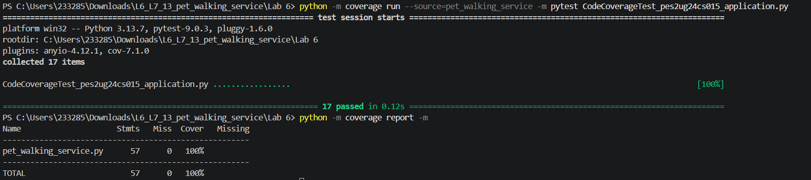
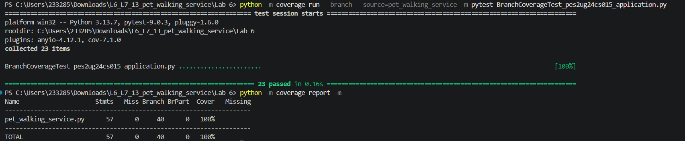

# Lab 6: Code and Branch Coverage Analysis

**Course:** Software Engineering

**Name:** Aarushi Singh  
**SRN:** PES2UG24CS015  
**Section:** 5A CSE

**Repository:** [L6_L7_13_pet_walking_service](https://github.com/aarushisingh236/L6_L7_13_pet_walking_service)

## Objective

To understand and apply code coverage and branch coverage analysis using Python's `coverage` and `pytest` libraries.

## Project Files

| File | Description |
|---|---|
| `pet_walking_service.py` | Original application |
| `test_pet_walking.py` | Original test cases |
| `CodeCoverageTest_pes2ug24cs015_application.py` | Additional tests for code coverage |
| `BranchCoverageTest_pes2ug24cs015_application.py` | Additional tests for branch coverage |
| `screenshots/` | Coverage report screenshots |

## Tools Used

- Python 3.13
- pytest
- coverage.py
- Visual Studio Code
- Git and GitHub

## Coverage Results

| Metric | Result |
|---|---:|
| Code Coverage | **100%** |
| Branch Coverage | **100%** |
| Code Coverage Tests | 17 passed |
| Branch Coverage Tests | 23 passed |
| Total Statements | 57 |
| Total Branches | 40 |

## Screenshots

### Code Coverage

### Branch Coverage

## Conclusion

Successfully performed code coverage and branch coverage analysis on the Pet Walking Service application. Additional test cases were written to cover different conditions, decision branches, and edge cases, achieving 100% code coverage and 100% branch coverage.